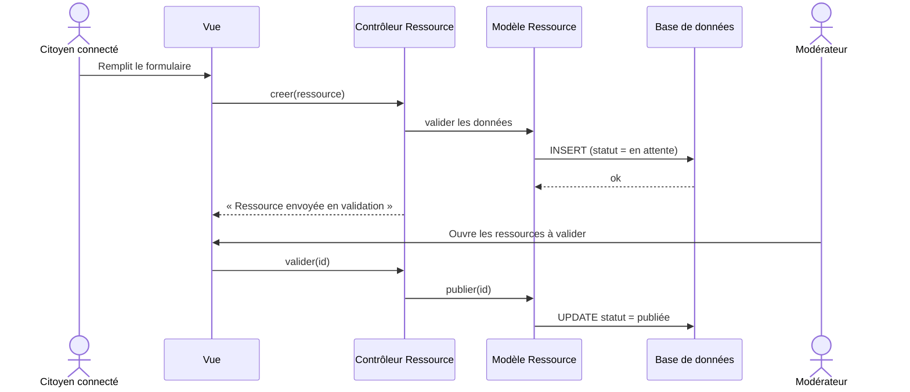

> [!consigne]- Ce qu'on attend ici · objectif ≈ 1 page(s) · Camille écrit, Alescis relit
> Illustrer le fonctionnement sur **1 ou 2 scénarios clés** avec des diagrammes de séquence (ou d'activité).
> - Scénario conseillé : un citoyen crée une ressource, un modérateur la valide, elle devient publique.
> - Montrer les couches MVC (Vue, Contrôleur, Modèle, BDD) pour faire le lien avec [[11 - Architecture logicielle]].
> - Le diagramme peut s'écrire directement ici en **Mermaid** (texte, donc zéro conflit Git et rendu dans Obsidian et le PDF). Exemple pré-rempli ci-dessous.
> - Ressources utiles : [[Ressources BLOC 1]]

## 10. Scénarios et séquences

### Créer et publier une ressource

%% À adapter : ajouter les cas d'erreur (alt), les notifications, etc. %%

## À l'oral
%% Ce qui ira sur la slide : 3 à 5 puces, des mots-clés, un schéma. Repris tel quel dans [[Soutenance BLOC 1]]. %%
- Le parcours « créer → valider → publier »

## Remarques de relecture
%% Zone de Alescis : écrire seulement ici. Camille corrige au-dessus puis passe le statut à « fait ». %%
