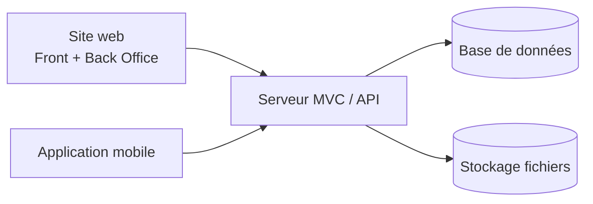

> [!consigne]- Ce qu'on attend ici · objectif ≈ 1,5 page(s) · Alescis écrit, Oumar relit
> Mission 2 : « modélisation de l'architecture logicielle ». Le sujet impose une approche **design pattern** et en particulier **MVC**.
> - Un schéma d'ensemble : clients (site web, appli mobile) → API / serveur MVC → base de données, + services (authentification, stockage des fichiers, statistiques).
> - Expliquer MVC appliqué à notre projet (un exemple concret : ressource).
> - Justifier les **choix technologiques** (langage, framework, BDD, mobile) en 1 ligne chacun : on est jugés sur la cohérence, pas sur la mode.
> - Citer 1 ou 2 autres design patterns utiles (Repository, Observer pour les notifications…).
> - Ressources utiles : [[Ressources BLOC 1]]

## 11. Architecture logicielle

### Vue d'ensemble

### Le modèle MVC dans notre projet

### Choix technologiques
| Brique | Choix | Pourquoi |
| --- | --- | --- |
| Back-end |  |  |
| Front web |  |  |
| Mobile |  |  |
| Base de données |  |  |

## À l'oral
%% Ce qui ira sur la slide : 3 à 5 puces, des mots-clés, un schéma. Repris tel quel dans [[Soutenance BLOC 1]]. %%
- Schéma d'architecture
- MVC en une phrase
- Nos choix techniques

## Remarques de relecture
%% Zone de Oumar : écrire seulement ici. Alescis corrige au-dessus puis passe le statut à « fait ». %%
