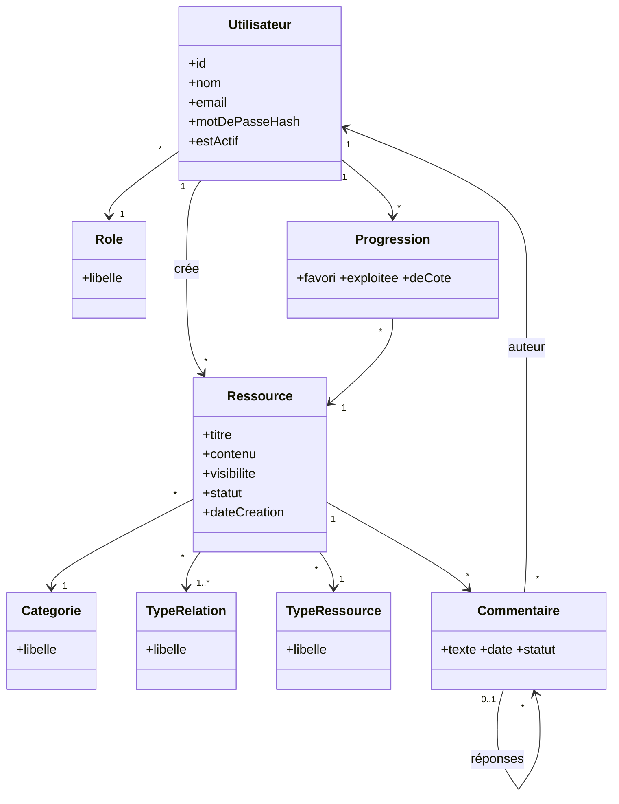

> [!consigne]- Ce qu'on attend ici · objectif ≈ 1,5 page(s) · Camille écrit, Alescis relit
> Diagramme UML **exigé** pour la conception. Il doit être cohérent avec le MCD de [[13 - Base de données (MCD et MLD)]] : se caler avec Oumar.
> - Classes métier : Utilisateur, Rôle, Ressource, Catégorie, TypeRelation, TypeRessource, Commentaire, Progression (favori, exploitée, de côté), Partage, Activité / Participation, Message, Statistique.
> - Mettre les **multiplicités** (une ressource = 1 catégorie, 1..* types de relations), les attributs principaux, quelques méthodes.
> - Écrit en **Mermaid** ci-dessous (point de départ à corriger et compléter).
> - Ressources utiles : [[Ressources BLOC 1]]

## 12. Diagramme de classes

### Diagramme

### Explications
%% 5 à 10 lignes : choix importants, règles métier traduites dans le modèle. %%

## À l'oral
%% Ce qui ira sur la slide : 3 à 5 puces, des mots-clés, un schéma. Repris tel quel dans [[Soutenance BLOC 1]]. %%
- Le diagramme de classes (zoom sur Ressource)

## Remarques de relecture
%% Zone de Alescis : écrire seulement ici. Camille corrige au-dessus puis passe le statut à « fait ». %%
